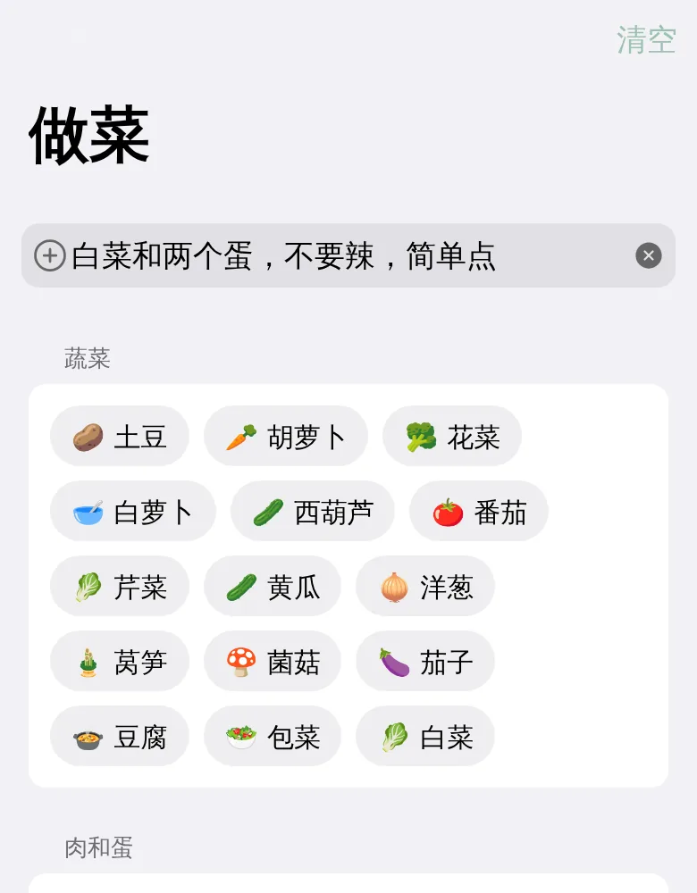
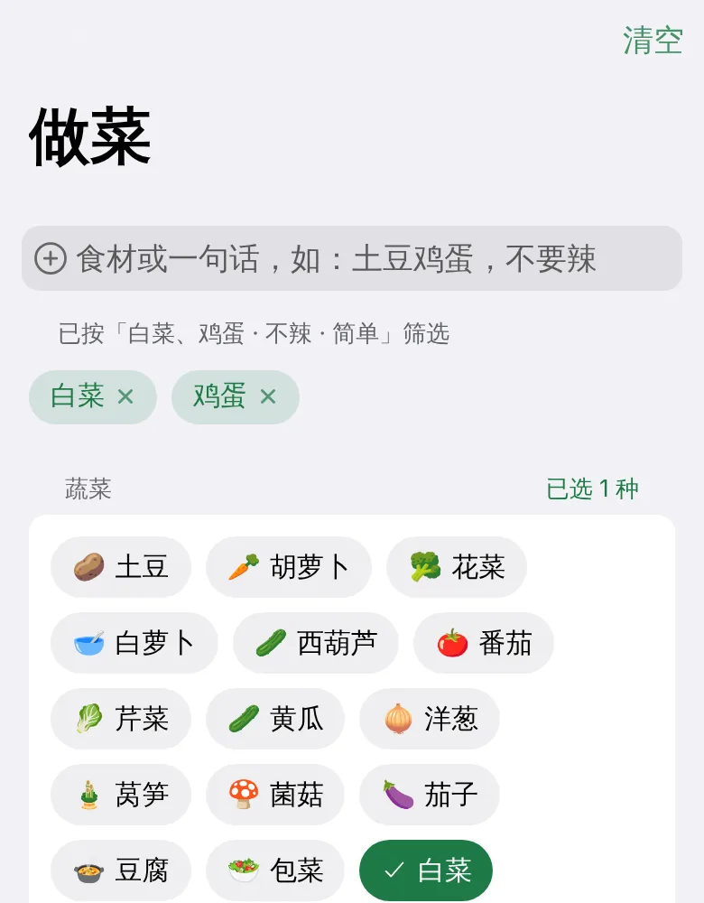
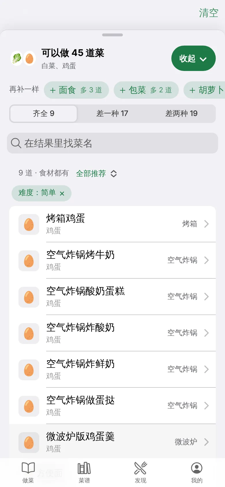
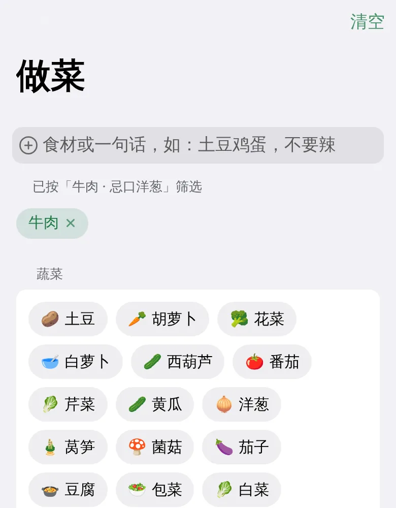
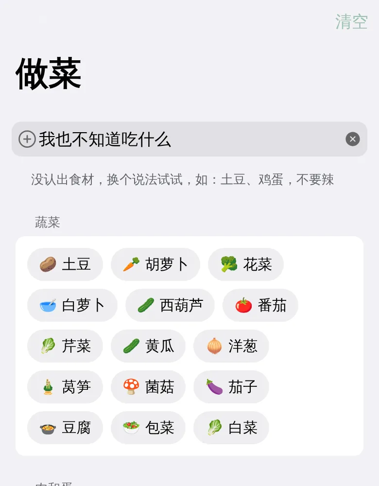

# 一句话找菜

做菜页顶部的输入框除了填食材，也可以直接说一句话，比如「白菜和两个蛋，不要辣，简单点」。按回车后，Cook 会把这句话拆成食材和筛选条件，结果和你手动点选的一样。

  <figure>
    
    <figcaption>输入一句话，按回车</figcaption>
  </figure>
  <figure>
    
    <figcaption>输入框下面会说明按什么筛选</figcaption>
  </figure>
  <figure>
    
    <figcaption>点「查看菜谱」看结果</figcaption>
  </figure>

## 能听懂哪些说法

| 想表达     | 可以这样说                               | 效果                     |
| ---------- | ---------------------------------------- | ------------------------ |
| 有什么食材 | 冰箱里有土豆和鸡蛋、剩半颗白菜、想吃牛肉 | 选中这些食材             |
| 不吃什么   | 不要洋葱、不吃香菇、洋葱不要、虾过敏     | 加进忌口，推荐里不会出现 |
| 没有什么   | 没有葱、家里没鸡蛋了                     | 这样食材不会被选上       |
| 不吃辣     | 不要辣、不吃辣、清淡点                   | 打开「不辣」             |
| 想简单点   | 简单、快手、新手、懒人、15 分钟能做的    | 难度筛到「简单」         |
| 想来个硬菜 | 硬菜、大菜、有难度                       | 难度筛到「困难」         |
| 做法       | 炒、煲汤、炖、蒸、煎、烤、凉拌           | 筛选对应做法             |
| 厨具       | 用电饭煲、空气炸锅、微波炉               | 选中这个厨具             |

几种说法可以用逗号连在一起，比如「想吃牛肉，洋葱不要，用电饭煲」。蛋、鸡、西红柿这类常见叫法会自动换成菜谱里的名字。

  <figure>
    
    <figcaption>「洋葱不要」会进忌口</figcaption>
  </figure>
  <figure>
    
    <figcaption>没认出时会提示换个说法</figcaption>
  </figure>

## 小提示

- 识别结果会合进当前的选择，不会清掉你已经点好的食材。想重来，点右上角「清空」。
- 选错了就点食材标签上的 ×，或者在下面的列表里再点一下取消。忌口、不辣和难度可以在筛选里改回来。
- 只填食材时和以前一样，比如「土豆 鸡蛋」或「土豆、鸡蛋」。
- 识别完全在本地完成，不联网，也不会上传你输入的内容。
- 菜单里没有的食材（比如自己添加的菜谱里用到的）也会按原样加上。

